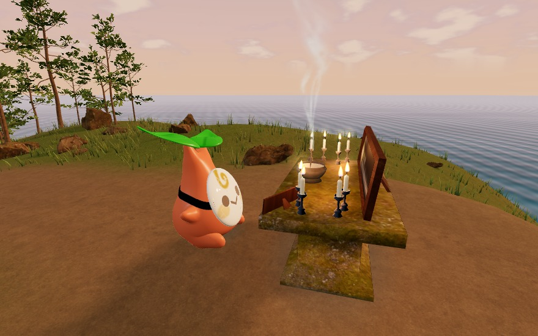

# L'autel

[Jouer en ligne](https://tzubu.github.io/l-autel/)

À la base, je voulais juste faire une petite scène en 3D. Il y a un chemin qui mène à un autel au bord de la mer, avec Pouet, des bougies et de la fumée d’encens. J’ai surtout bossé sur l’ambiance et le mouvement de caméra autour de l’autel. La prière, c’est un petit truc rigolo que j’ai rajouté.



## Pour jouer

Ça se joue sur ordi, au clavier et à la souris. Clique sur **Commencer**, puis suis le chemin jusqu’à l’autel.

- **ZQSD** ou les flèches pour marcher, **Espace** pour sauter.
- **E** devant l’autel pour faire asseoir Pouet.
- **Échap** pour libérer la souris ou fermer le formulaire.

## Lancer le projet en local

Il te faut Node.js. Dans le dossier du projet, lance ces deux commandes.

```sh
npm ci
npm run build
```

Ça crée `L'autel.html`. Tu peux l’ouvrir par double-clic, même hors ligne. Pour refaire la version en ligne dans `docs/`, lance `node build.mjs --web`.

## Crédits

- L’autel, Pouet et le poème viennent de la première version du projet.
- [Grass Ground](https://polyhaven.com/a/grass_ground) par Charlotte Baglioni et Poly Haven, CC0 1.0. Couleur et normales adaptées au terrain.
- [Grass 004](https://ambientcg.com/view?id=Grass004) par ambientCG, CC0 1.0. Couleur combinée à celle du terrain.
- [Rock Moss Set 01](https://polyhaven.com/a/rock_moss_set_01) par Kless Gyzen et Poly Haven, CC0 1.0. Géométrie allégée pour le jeu.
- [Pine Trees Pack Lowpoly Game Ready LODs](https://sketchfab.com/3d-models/pine-trees-pack-lowpoly-game-ready-lods-e1e9c07b8e2e445c943fec660beefba2) par LOLIPOP, Creative Commons Attribution. Modèles du prototype optimisés et replacés sur le terrain.
- Three.js 0.160.1, licence MIT incluse dans `LICENSE-Three.txt` et dans le HTML.
